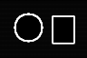

# Prism-Forge

Prism-Forge is a compact C++17 CPU image-processing command-line application. It reads PNG, JPEG, and PPM images; applies a sequential filter pipeline; and writes PNG, JPEG, or PPM. It also supports safe, non-recursive directory batches.

## Run it

```sh
prismforge --input photo.png --output result.png \
  --filter 'blur:radius=3,sigma=1.5' --filter 'sharpen:amount=0.8'
prismforge --input-dir photos --output-dir processed --filter grayscale --format png
```

See [`docs/QUICK_START.md`](docs/QUICK_START.md) for usage and [`prismforge --help`](#) for command syntax. Outputs are never replaced unless `--overwrite` is supplied. Output format comes from the extension; input format comes from file contents.

Download the smoke-tested [Linux x86-64 release-candidate archive](https://github.com/badmrfrosty313/Prism-Forge/actions/runs/39658431874) or [Windows x86-64 ZIP](https://github.com/badmrfrosty313/Prism-Forge/actions/runs/39658431874) from the run's Artifacts section. These are CI artifacts, not a published release.

## Build and test

Requirements: CMake 3.18+ and a C++17 compiler (GCC, Clang, or MSVC). The PNG/JPEG codec is pinned stb_image/stb_image_write; there are no other third-party runtime dependencies.

```sh
cmake -S . -B build -DCMAKE_BUILD_TYPE=Release
cmake --build build --parallel 2
ctest --test-dir build --output-on-failure
```

For Visual Studio, pass `--config Release` to build and CTest. Configure `-DPRISMFORGE_ENABLE_SANITIZERS=ON` with GCC or Clang to enable ASan and UBSan.

## Filters

Filters execute in the order supplied. Repeat `--filter` to compose them; an empty pipeline copies/converts the input unchanged.

| Filter | Parameters and defaults |
| --- | --- |
| `blur` | `radius=3`, `sigma=1.5`; radius 0–128, sigma finite and positive |
| `sobel` | 3×3 Sobel gradient magnitude, grayscale output |
| `color` | `brightness=0`, `contrast=1`, `saturation=1`; contrast/saturation nonnegative |
| `grayscale` | Rec. 601 luma |
| `sharpen` | `amount=1`, 0–10; center plus amount times the four-neighbor Laplacian |
| `invert` | Invert RGB |
| `resize-nearest` | Required positive `width` and `height` |
| `resize-bilinear` | Required positive `width` and `height`; pixel-center interpolation |

Blur and Sobel replicate edge pixels. Resize limits follow the same image-dimension and pixel-count limits as decoding. Color, grayscale, sharpen, invert, blur and Sobel preserve alpha. Resampling interpolates alpha as well as RGB.

## Formats and safety limits

PNG: 8-bit RGB/RGBA input and PNG output. JPEG: 8-bit RGB input and JPEG output with `--quality 1..100` (default 90). PPM: P3/P6 input with max sample 255; P6 output. Decoders enforce a 64 MiB encoded-input limit, 16,384 pixels per axis, and 16 Mi pixels total. PPM and JPEG encoders reject non-opaque alpha instead of silently discarding it. Output uses the filename extension (`.png`, `.jpg`/`.jpeg`, `.ppm`).

The codec is stb_image/stb_image_write pinned to upstream commit [`a7d4c2175630e1ea5b6f8dd00ab96fed0b97b96d`](third_party/stb/README.md), under its MIT/public-domain dual license. It is a small single-header dependency and has not received an independent security audit; only PNG/JPEG paths are compiled in. Metadata is not preserved: EXIF orientation is not applied, ICC profiles are ignored, and there is no color management. Images are treated as 8-bit channel samples.

Batch mode is non-recursive. It creates the destination directory, supports only `.png`, `.jpg`, `.jpeg`, `.ppm` input extensions, skips other files with a summary, and fails if a supported image fails. Existing destination files are protected by default. Input/output directory overlap is rejected.

## Gallery

These browser-viewable PNGs were made by Prism-Forge from the genuine P6 PPM filter results in `examples/outputs/`:

| Original | Blur | Sobel | Color |
| --- | --- | --- | --- |
|  |  |  |  |

| Grayscale | Sharpen | Bilinear resize | Pipeline |
| --- | --- | --- | --- |
|  |  |  |  |

Corresponding PPM application outputs and PNG previews are generated in CI and attached as downloadable artifacts with JUnit XML and benchmark CSV. The PNG previews use the program's format conversion path; no external imaging dependency is needed.

## Benchmark and validation

`prismforge_bench [width] [height] [repetitions]` prints CSV for the existing filters, resizing, and a multi-filter pipeline. It reports total/mean filter time and a per-result checksum. Hashing is outside the timed interval; each checksum is consumed by a volatile sink to make output observable. Times are machine-specific and have no CI performance threshold. See [`docs/VALIDATION.md`](docs/VALIDATION.md) for actual verified test and CI results.

Release-candidate packaging and platform requirements are described in [`docs/RELEASE.md`](docs/RELEASE.md). The app and bundled stb notices are MIT-compatible; see [`LICENSE`](LICENSE) and [`third_party/stb/LICENSE`](third_party/stb/LICENSE).

For portfolio use, see [`docs/PORTFOLIO.md`](docs/PORTFOLIO.md); it identifies the project as AI-assisted and a personal project.
